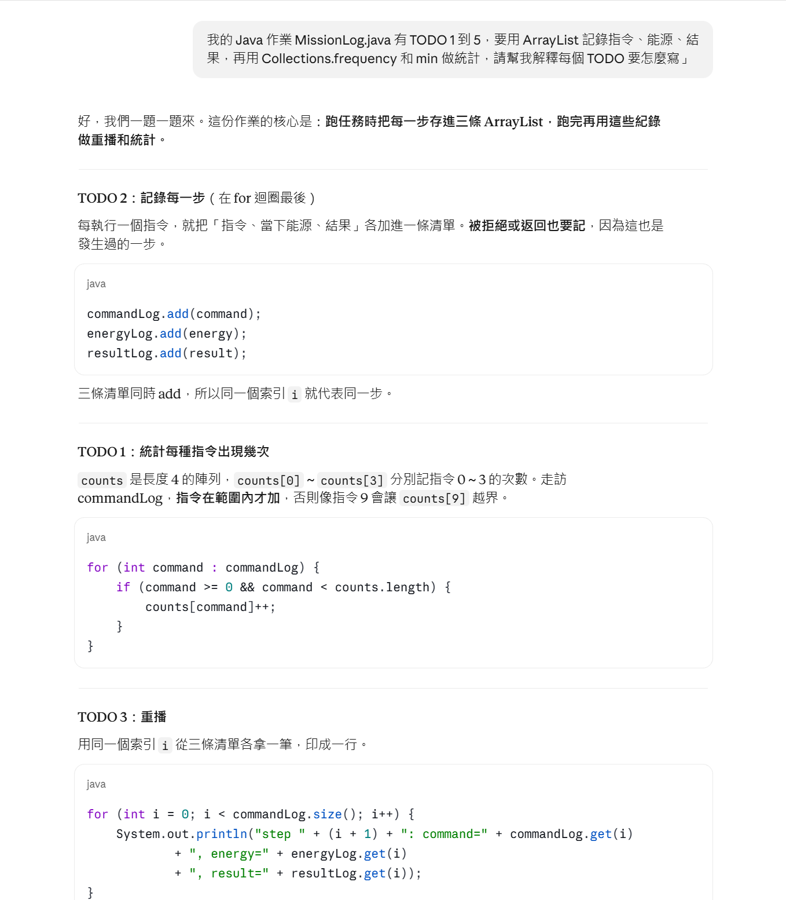

# 第四週 AI 使用紀錄

| 欄位 | 記錄 |
|---|---|
| 使用工具 | Claude（Anthropic） |
| 使用目的與提問摘要 | 1. 詢問如何在 VS Code 終端機用 javac/java 編譯執行 examples/ArrayBasics.java，並理解陣列預設值（int 為 0、String 為 null）與越界。2. 請 AI 協助完成 RoverMission 的 TODO D1–D3。3. 請 AI 解釋並協助完成 MissionLog 的 TODO 1–5（用三條 ArrayList 記錄指令、能源、結果，再用 Collections.frequency 與 min 統計）。 |
| AI 建議與本人處理 | 1. 第一次執行出現 file not found，AI 指出終端機位置錯誤，我 cd 到 115.10.30 後重新編譯成功。2. RoverMission：採納 if 檢查寫法，能源足夠才扣能源、加樣本並 actionCount++，不足只印提示；充電用 Math.min(energy + 5, 20) 封頂。3. MissionLog：採納每步都 add 到三條清單（拒絕與返回也記錄）；counts 保留 command >= 0 && command < counts.length 範圍檢查，避免無效指令越界；rejected = steps − ok − RETURN 次數，ignored = 腳本長度 − steps；取 min 前先用 isEmpty 判斷。第一次執行仍是舊輸出，發現是檔案沒存檔，存檔後重新編譯。 |
| 實際驗證結果 | ArrayBasics 輸出 sum=4，與老師示範一致。RoverMission 從 energy=20 開始：輸入 3 印 ENERGY_FULL 且 actionCount 仍為 0；連續輸入 1 三次後 samples=6，印 SUCCESS。MissionLog 腳本 {1,1,2}：replay 三步皆 OK，counts[0..3]=[0, 2, 1, 0]、steps=3、ok=3、rejected=0、ignored=0、lowest energy=6，最後 energy=6、samples=5、actionCount=3，結果 SUCCESS。 |

只記錄實際發生的操作。AI 宣稱正確不能取代編譯執行。不要上傳個資、密碼、憑證或未授權資料。

## 對話截圖

