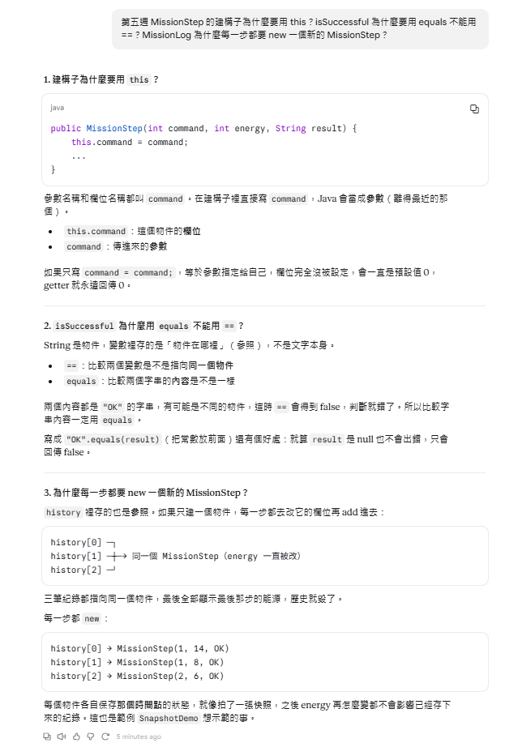

# 第五週 AI 使用紀錄

| 欄位 | 本人紀錄 |
|---|---|
| 使用工具／方式 | 真實 AI：Claude（Anthropic） |
| 目的與提問摘要 | 請 AI 協助完成 starter 的 MissionStep TODO 1–3（建構子用 this 保存三個欄位、三個 getter、isSuccessful 以內容比較判斷 OK），以及 MissionLog TODO 4–6（每步新增一個 MissionStep 到 history、用 getter 回放、走訪 history 計算 OK 與 RETURN）。 |
| 建議與本人處理 | 採納：每一步都 new 一個新的 MissionStep 存當下能源（快照），拒絕、無效與返回也記錄；字串比較用 equals 而非 ==。AI 另建議 TODO 6 可改用 isSuccessful()，我保留 getResult().equals("OK") 寫法，結果相同。另外發現 115.10.30 與 115.11.6 都有 MissionLog，按 Run 可能執行到上週版本，因此改用 cd 115.11.6 後以 javac starter/*.java 手動編譯執行。 |
| 本人實際驗證 | 腳本 {1,1,2}：replay 三步皆 OK，counts[0..3]=[0, 2, 1, 0]、steps=3、ok=3、rejected=0、ignored=0、lowest energy=6，final 6/5/3 SUCCESS，與第四週輸出相同。反例 {3,9,0}：ALREADY_FULL、UNKNOWN_COMMAND、RETURN，counts[0..3]=[1, 0, 0, 1]、steps=3、ok=0、rejected=2、ignored=0、lowest energy=20，final 20/0/0 RETURNED；指令 9 未造成越界。第一次改反例時未存檔，輸出仍是 {1,1,2}，存檔後重跑得到上述結果。 |

AI 的正確宣稱不能代替編譯執行。

## 對話截圖

## 對話截圖
