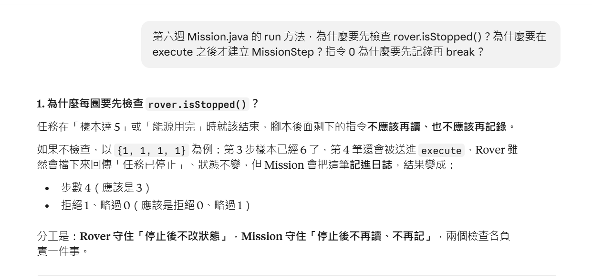
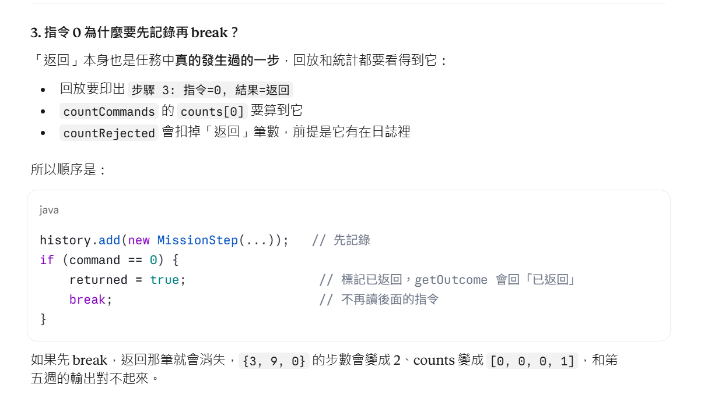

# 第六週 AI 使用紀錄

| 欄位 | 本人紀錄 |
|---|---|
| 使用工具／方式 | 真實 AI：Claude（Anthropic） |
| 目的與提問摘要 | 1. 請 AI 說明 starter 各檔角色（Rover、MissionStep、MissionLog、RoverDemo 為教師提供，只需完成 Mission）。2. 請 AI 提示並協助完成 Mission TODO 1–3：run（先檢查 isStopped、execute 後建立 MissionStep 快照、指令 0 先記錄再停止）、countOk（用 isSuccessful 計數）、lowestEnergy（空清單回傳 -1）。3. 追問 run 為何要先檢查 isStopped、為何 execute 後才建立快照、為何指令 0 先記錄再 break。4. SampleCase 設計：待補。 |
| 建議與本人處理 | 採納 AI 對 run 的順序：每圈先檢查 rover.isStopped()，呼叫 execute 後才用 rover.getEnergy() 建立快照，確保記錄的是行動後能源；指令 0 先加入 history 再設 returned=true 並 break。確認本週結果字串是「成功」而非上週的 "OK"，所以 countOk 使用 isSuccessful()。執行時誤把 Java 原始碼 PrintStream.java 存進 starter 造成 89 個編譯錯誤，刪除後恢復正常；另發現按 Run 會執行到 RoverDemo，改用 javac/java 指令執行 MissionLog。 |
| 本人實際驗證 | RoverDemo 輸出 成功/14/2/1、任務已停止/0、任務已停止/20。D3 六條路線全部與講義預期一致（完整輸出見 LAB_REPORT D3）：{1,1,2} 6/5/3 任務成功；{3,9,0} 20/0/0 已返回、拒絕=2；{0} 已返回；{2,2,2,2,2} 10/5/5 任務成功；{1,1,1,1} 只執行 3 步、略過=1 且日誌無「任務已停止」，證明停止檢查有效；{2,1} 12/3/2 任務未完成。E3 SampleCase 反例：待補。 |

AI 的正確宣稱不能代替編譯執行。

## 截圖

**圖 1｜AI 建議圖（來源：Claude 對話）**：提問 run 為何要先檢查 rover.isStopped()。AI 以 {1,1,1,1} 說明若不檢查會多記一筆「任務已停止」，步數變 4、拒絕 1、略過 0；本人實測停止檢查後為步數 3、略過 1，與說明一致。

**圖 2｜AI 建議圖（來源：Claude 對話）**：AI 說明指令 0 為何先記錄再 break，否則 {3,9,0} 步數會變 2、counts 變 [0,0,0,1]。本人實測 {3,9,0} 為步數 3、counts=[1,0,0,1]，返回那筆有被記錄。

## 我的反思

哪一句需求幫我判斷 AI 建議：「成功或耗盡後，停止後的指令不讀也不記」。
AI 說 run 每圈要先檢查 rover.isStopped()，我用這句需求判斷：如果只靠 Rover 擋下行動，第 4 筆仍會以「任務已停止」被記進日誌，違反「不記」。實際跑 {1,1,1,1} 得到步數 3、略過 1、日誌沒有「任務已停止」，才確認這個建議是對的。

只看類別圖還不能證明什麼：類別圖只能看出 Mission 有 run、countOk、lowestEnergy 這些方法和 history、returned 欄位，以及 Mission 連到 Rover 和 MissionStep，但看不出 run 裡面「先檢查 isStopped、execute 之後才建立快照、指令 0 先記錄再 break」的順序。這些執行順序和停止時機只能靠追蹤程式和實際執行（例如 {1,1,1,1} 和 {3,9,0}）來證明。