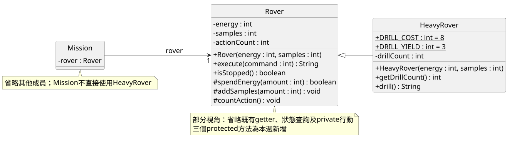

# 第七週 DESIGN

## 1. 繼承圖（diagrams/heavy_practice.puml → heavy_practice.svg）

- 空心三角形實線 `Rover <|-- HeavyRover`，三角形指向父類別 Rover。
- Rover 列出三個 private 欄位，以及本週新增的三個 protected 方法（UML 以 `#` 表示）：spendEnergy、addSamples、countAction。
- HeavyRover 只列自己新增的成員：兩個 static 常數、drillCount、建構子、getDrillCount、drill；繼承來的 execute、getter 不再畫一次。
- Mission 仍只關聯 Rover（`Mission --> "1" Rover`），不畫 Mission→HeavyRover，因為 Mission 的程式沒有用到 HeavyRover。
- 這是部分視角：省略的 getter 與 private 行動方法不代表不存在。

## 2. D1 關係判斷

| 類別 | 關係 | 理由 |
|---|---|---|
| VipMember 與 Member | is-a（繼承） | VIP 是一種會員，購物得點等原有規則也適用。 |
| HeavyRover 與 Rover | is-a（繼承） | 重型探測車是一種探測車，探索、掃描、充電與停止規則都沿用。 |
| Mission 與 Rover | has-a（欄位） | 任務「使用」一台車，不是一台車。 |
| Mission 與 MissionStep | has-a（欄位） | 任務有多筆日誌紀錄。 |

如果寫 `Mission extends Rover`，`mission.execute(1)`、`mission.getEnergy()` 都會變成合法呼叫，但任務不是一台車，這些操作不合理。

## 3. 設計重點

- HeavyRover 不重複宣告 energy、samples、actionCount。這些欄位是 Rover 的 private，子類別不繼承，但 HeavyRover 物件裡仍有這一份資料，由 Rover 的方法存取。
- 子類別透過 Rover 的 protected 方法（spendEnergy、addSamples、countAction）更新狀態，不把欄位改成 protected，扣能源規則只寫在 spendEnergy 一個地方。
- drill 是新的公開入口，不經過 execute，所以要自己先檢查 isStopped()。
- spendEnergy 先檢查再扣：amount <= 0 或超過目前能源就回 false，能源不變。

## 4. 課後獨立遷移：路線 A CargoRover

### 規格
- `CargoRover extends Rover`；建構子 `CargoRover(int energy, int samples)`，第一行 `super(energy, samples)`。
- `private int cargo`，初始 0；`getCargo()` 回傳它；容量固定 3（常數 CAPACITY）。
- `String load(int amount)`：
  - 已停止 → 任務已停止
  - amount <= 0 或超過剩餘貨位 → 已拒絕（cargo 不變）
  - 其餘 → cargo 增加，回成功
- 貨物不是科學樣本：load 不耗能源、不加樣本、不加 actionCount。
- 判斷用 `amount > CAPACITY - cargo`，避免先相加再判斷。

### 測試（CargoRoverTry，11 行全部相符，完整輸出見 LAB_REPORT）

| 案例 | 呼叫 | 預期 |
|---|---|---|
| 正常 | (20,0) load(2) | 成功/2 |
| 拒絕：超量 | 接著 load(2) | 已拒絕/2 |
| 邊界：剛好滿載 | 接著 load(1) | 成功/3 |
| 拒絕：0 件 | 接著 load(0) | 已拒絕/3 |
| 不影響原狀態 | 三個 getter | 20/0/0 |
| 停止：耗盡 | (0,0) load(1) | 任務已停止/0 |
| 停止：已達標 | (20,5) load(1) | 任務已停止/0 |
| 拒絕：負數 | (20,0) load(-1) | 已拒絕/0 |
| 邊界：一次裝滿 | (20,0) load(3) | 成功/3 |
| 滿載後再裝 | 接著 load(1) | 已拒絕/3 |
| 沿用父類別行為 | 接著 execute(1) | 成功/14/2/1/3 |
